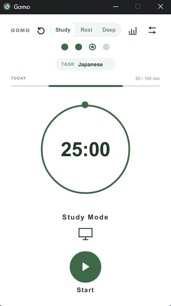
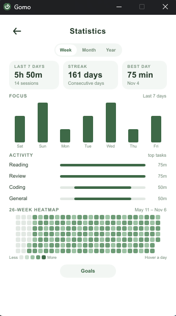
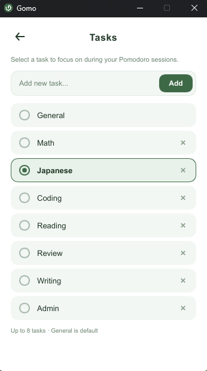
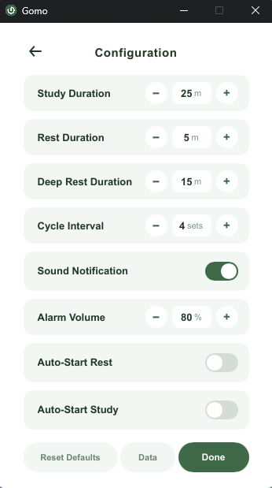

<p align="center"></p>
<h1 align="center">Gomo</h1>

Gomo is a small Windows study timer built with Rust and Slint. It draws with a
software renderer and keeps all of its data in a local folder.

## Features

- Study, Rest, and Deep Rest timer modes
- Custom tasks, daily goals, and weekly goals
- Focus statistics with Week/Month/Year views, task activity, and a 26-week heatmap
- Session history stored in SQLite
- Native system tray with close-to-tray behavior
- In-app completion banner, alarm, and taskbar flash
- CSV/JSON export and import, plus backup and restore from the last backup
- One-time migration of legacy Podomoro data
- No GPU driver dependency; works on older Windows machines, VMs, and RDP

## Screenshots

Screenshots use sample data.

| Study timer | Statistics |
| :---: | :---: |
|  |  |

| Tasks | Settings |
| :---: | :---: |
|  |  |

## Requirements

- Windows 10 or Windows 11, x64

## Install

### Portable

Extract `Gomo.exe` and run it. No installation or administrator access is needed.

### Installer

Run `Gomo-<version>-setup.exe`. The installer is per-user, creates Start Menu and
optional desktop shortcuts, and includes an uninstaller. Uninstalling removes
the application files but leaves your timer data in place.

The current build is unsigned, so Windows SmartScreen may show a warning.

## Keyboard shortcuts

Shortcuts are active on the main timer screen only:

- `Space`: start or pause
- `R`: reset the current session
- `S`: skip to the next mode
- `1`: Study
- `2`: Rest
- `3`: Deep Rest

## Data

Gomo stores its data in `%LOCALAPPDATA%\Gomo`:

- `config.json`: settings, tasks, and goals
- `stats.db`: statistics and session history
- `stats.db.bak`: latest database snapshot
- `stats.db.pre-restore`: safety snapshot created before a restore
- `gomo.log`: application log

If a legacy `%LOCALAPPDATA%\Podomoro` or `%APPDATA%\Podomoro` folder exists, its
data is copied into Gomo once. The old folder is left untouched.

Backups and restores are available from Settings → Data.

## Build

```powershell
cargo build --release --locked
cargo test
cargo clippy --all-targets -- -D warnings
cargo fmt --all -- --check
```

The release executable is `target/release/gomo.exe`.

## License

MIT. See [LICENSE](LICENSE).
